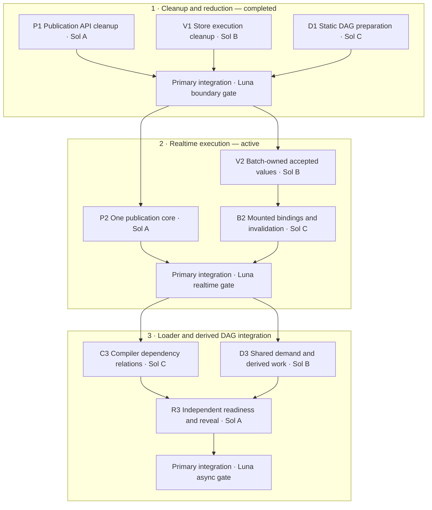

# Three integrated architecture slices

Implementation is authorized. This executes the [architecture proposal](../2026-10-22-architecture-reassessment/proposal.md) through the single master guide. The human permits deletion of superseded runtime APIs, schemas and implementation paths; there is no backwards compatibility requirement. Historical evidence stays immutable. The maintainability-review skill workflow is set aside at the human's request.

## Task dependencies and ownership

P1/V1/D1 completed in `2f4c1c6f4`. P2/V2/B2 are dispatched to the same Sol-medium agents with disjoint ownership. Slice3 remains dependency-blocked. Luna is idle during implementation. The primary owns public exports, installed examples, delivery scripts, current documentation, integration review and checkpoint updates. No implementation agent runs tests or benchmarks.

## Slice 1: reduce execution machinery

P1 owns `component_state_runtime.ts`, `native_root_work_queue.ts`, publication-domain code and related current tests. Replace retained/collection/resource queue wrappers with `enqueueTransaction`; retain `enqueueStores` because its continuation semantics differ. Remove unused candidate publication parameters and duplicated resource-lease coverage. Use only sealed bound Store schedules, declining before effects into the existing generic/nonpassive route.

V1 owns closed Store execution, scalar output, capture and kernel proof modules and current tests. Retire execution schemas1/2 and obsolete scalar-kernel proof adapters; current Rust emits execution schema3. Host-program schemas are a different ABI and remain when current Rust emits them. Retain schema3 interpreted fallback. Remove raw per-frame request normalization, including dead test-only wrappers; migrate capture/ack adversaries onto bound schedules.

D1 owns async scheduler/plan, native task execution/transition and related tests/config. Delete the unexported standalone synchronous TaskGraph prototype and sole runners; old source remains in Git and the prior immutable source archive. Snapshot static native task relations once per queued operation; new input generations retain their own resource, cancellation and result state. Preserve actual compiler task binders and the native loader DAG.

**Authority and semantics:** existing Store histories, World cells, Root candidate lifecycle, VDOM bindings and host-domain claims remain canonical. Preserve exact captured acknowledgements, newer reentrant actions, per-root accepted histories/forks, source/code/writer liveness, resource lifetime, generic fallback and partial-failure quarantine. Cleanup cannot silently remove active authored behavior. No new identity/version registry.

**Budget and falsifier:** no removable-time estimate or cleanup speed promise. Latest scoped Native update median2.50–2.60ms/p902.80 versus React0.60/0.70 is the baseline context, not a guaranteed delta. Lost behavior, mutable accepted snapshots, stale publication, changed callback ordering or broader work per unrelated input falsify this slice. Consolidated checks and one bounded matched comparison follow source review.

## Slice 2: integrated realtime execution

Before edits, agree the batch-page/binding interface and revocation contract. P2 routes the ordinary eligible one-root public frame through the existing immediate candidate lifecycle, and migrates numeric acceptance from its separate direct path into that same core. Deferred/opaque/structural work and explicit groups retain coordination. P2 owns Root/queue/frame-driver files.

V2 replaces eligible per-owner output descriptors/frame wrappers with immutable batch-owned accepted values or changed chunks. Old public observations and forks pin accepted data by ordinary references; no mutable buffer rotation under snapshots, manual-release obligation, finalizer dependence or permanently retained version chain. V2 owns output/execution/capture modules. B2 owns VDOM/mounted binding integration: resolve static target/layout work at mount, revoke on source membership/rebind, topology, code or lifetime changes, and repair affected mounted regions. Keep full live reader sweeps until all mutation paths prove revocation. Binding integration depends on V2's interface, while source mapping can proceed alongside P2/V2.

**Authority and retirement:** reuse existing owner/source/code identities, Root acceptance and host claims. Retire eligible frame-local schedule/facade reconstruction and row adoption only after replacements are integrated. Preserve old accepted views during applying, per-write and final live checks, exact ack, failure quarantine, snapshot enumeration/materialization and generic fallback. Stable/copy-valued host writers are not presumed callback-free. Whole-tree/cache candidates keep whole-root guards.

**Budget and falsifier:** target same-run React parity or better for the authored realtime interaction at median+p90; there is no evidence yet promising0.6ms. Cold/memory costs must remain explicit. Snapshot aliasing, missed membership revocation, unsafe replay after writes, newer-action loss or a second publication authority are hard failures. A timing loss is reported for the integrated system, not used to repeatedly revert isolated helpers.

## Slice 3: dependency-scoped orchestration

C3 owns compiler task/dependency metadata and registration: distinguish hard prerequisites, invalidation/control reads and candidate-local discovery, with actual code/input provenance and conservative opaque boundaries. D3 owns provider demand/derived reuse through existing source/resource authorities: share only explicitly pure work within matching input versions, code revision and scope; provider-owned in-flight requests need interested-owner leases and last-owner abort. Borrowed promises are not owned cancellation.

R3 owns ready-frontier/native transition/reveal integration. Known-key branches start together; unknown keys wait for real prerequisites. Unrelated branches and hosts progress independently; explicit transactions determine agreed output groups. Forks may share transport/results while preserving separate accepted histories/reveal policy. Clock-only work does not traverse the full loader graph. R3 integrates after C3/D3 interfaces and Slice2 publication authority are ready.

**Authority, budget and falsifier:** same Root publication and source/code/version authorities. Retire duplicated discovery/preparation and coarse supersession only where active semantics are replaced. Existing equal-knowledge DAG144.8ms versus React preload143.6ms is parity, not superiority. Compare equal preload knowledge, loader critical path, urgent progress and reveal behavior; report one bounded matched product comparison. Hidden effectful sharing, missing control edges, stale code/result reuse, request leaks, unrelated branch blocking or fork history merging falsify the design.

## Boundary protocol and finish line

Review and integrate the whole slice before freezing source. Luna runs consolidated frozen-Deno/Rust/compiled-fixture/package checks, authored installed output/resource/snapshot checks and actual HMR as appropriate; preserve failures and repair only demonstrated issues. Browser work is headless, bounded, interruptible, never focus-stealing and uses Portless HTTPS. Linux gets the authorized quick smoke, not an architecture matrix or VM project.

At each completed slice, one balanced minified-production ABBA/BAAB comparison uses median+p90 primary and retains raw p95/max. Both arms implement the same authored interaction; no source/agent/gate activity overlaps timing, no retries for favorable results, and no helper benchmark campaign. Separate capture-to-accepted publication from draw/readback and from async readiness/reveal. Finish still includes async UX, host/resource conformance, packaging/portability, cold/lifecycle/retained-memory costs, independent-device evidence before broad performance claims, and human evidence before any maintainability-advantage claim. Three slices do not redefine the full product finish line.
