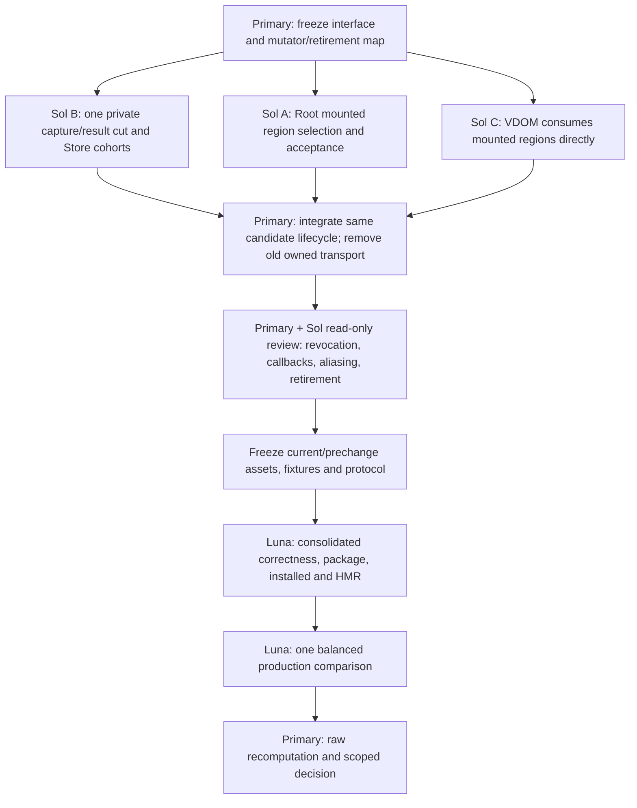

# One integrated mounted-region execution migration

Implement the candidate in [report](report.md) as one reviewed wave. Sol medium authors disjoint production changes and semantic fixtures; the primary reviews/integrates and maintains the master checkpoint; Luna remains idle until the full freeze. No helper timing, container experiment, automatic rollback sequence or concurrent benchmark activity.

**Work unit:** replace Root→Store→VDOM's repeated descriptions of stable mounted closed owners with one mounted execution representation and one private frame cut. Invariant authorities remain World incarnation/cells, Root membership/cache/acceptance, Store chronological history/root epochs, compiler/module revision, VDOM mounted/key geometry, host resource/domain lifetime and the existing candidate publisher. Current measured budget is2.40/2.70ms update median/p90, contemporary React0.60/0.70ms; removable share is unknown. Primary success target is same-run React parity on update median and p90, with through-draw non-regression and preserved semantics. Passing retirement alone is not that speed result.

## Lifetime design

Three existing lifetimes become explicit in the actual execution representation:

1. **Module:** existing normalized closed host/data execution, verified batch proof, layout and Rust/OXC revision. No new compiler schema is needed to restate facts already present. Real compiler provenance remains mandatory; hand-supplied functions/shape declarations do not acquire private authenticity.
2. **Mount:** each accepted `ComponentCache.output.shape` retains its bound inputs and opaque VDOM recipe, extended with immutable execution fields now reconstructed by `PassiveRow`. Existing `#mountedClosedStoreExecution` remains the single bounded Root composition slot. It contains ordered references to those mounted regions, existing group/chunk/remap geometry, unique Store/projection partitions and publication reader partitions. It never contains current accepted page values, captured action versions or a second history. VDOM owns target associations on its mounted nodes/key buckets; Root only holds opaque tokens.
3. **Update:** evolve the existing candidate-private `OwnedClosedFrameSchedule` into the one authentic owned frame cut used through capture, compute and VDOM. It references the mounted composition and contains new input buffers, canonical Store snapshots/root stamps, exact World cell cut, immutable output pages, current cache/VNode base references and state needed by the existing candidate lifecycle. Do not retain both Schedule and a new wrapping FrameCut with duplicate arrays. Rename/migrate the former class if that improves clarity, and delete its old transport signature/callers in the same wave.

Stable component/host/resource instances stay mounted. Immutable result pages and accepted output identities remain per-update because saved observations and forks must retain old values. Do not use a double buffer whose next reuse can alter an old snapshot. Do not retain historical cuts from mounted regions; ownership points from candidate/accepted output to plan/page, never from a long-lived plan to every prior candidate.

## Internal interface sketch and ownership

Names below are design notation for changes to existing modules, not a request for another public API or registry. **The conceptual design is ready for primary interface review; these sketches are not yet dispatch-ready executable signatures.** P0 must freeze those signatures and imports before parallel A/B/C implementation.

```ts
// ComponentCache.output.shape owns the Root half; VDOM owns its opaque binding.
type MountedClosedRegion = Readonly<{
  owner: OwnerId;
  program: ClosedStoreHostProgram;
  request: BoundClosedStoreOutputRequest;
  inputs: readonly BoundInput[];
  outputLayout: OwnedScalarLayout;
  authoredTemplate: ScalarOutputTemplate;
  expandedTemplate: ScalarOutputTemplate;
  target: MountedScalarStorePlan;
}>;

// Extend the existing immutable MountedClosedStoreExecution.
// Private fields contain regions in observable order, capture/group remaps,
// unique Store/path projections and reader IDs partitioned by Store.
// It is derived from, and invalidated by, existing authorities.

// Replace the existing candidate-private schedule payload, not the publisher.
// All fields/accessors below are private/canonical operations in implementation.
type OwnedFrameCutDescription = {
  mounted: MountedClosedStoreExecution;
  capturedStores: readonly CanonicalStoreCapture[];
  capturedCells: ClosedWorldCellCut;
  outputs: readonly OwnedScalarBatchPage[];
  // Exact accepted bases for THIS candidate; no mutable shared scratch.
  baseCaches: readonly ComponentCache[];
  baseVNodes: readonly MountedVNode[];
};
```

Root cannot construct a target pointer by structural typing. The existing VDOM recipe secret/private brand authenticates it. Likewise a caller cannot construct a valid cut by filling `OwnedFrameCutDescription`. Use a module-private constructor secret and private fields, captured accessors, frozen immutable geometry, one-shot seal/consumption, and rejection of proxy-wrapped capabilities. The only producer is the current bound-plan/canonical-capture pipeline. Merely freezing a caller object or accepting a private-branded page inside a public wrapper is insufficient.

The executable API migration is:

| Existing seam | Replace in place |
| --- | --- |
| `prepareOwnedClosedStoreOutputs(world, transaction, orderedRequests, ..., previousPlan)` | Accept the authenticated mounted composition already selected by Root; cold repair supplies the same composition type. Return the authentic cut rather than `{ rows, cellCut, plan }` plus per-row wrappers. Remove hot `unwrapOrderedRequests` and exact-order restatement; keep binding normalization in cold construction. |
| `OwnedClosedFrameSchedule.fromPlan(plan, groupInputs)` | Become the sole private capture/result cut, retaining private input/output ownership. No separate schedule façade surrounding a cut façade. |
| `StoreRenderTransaction._readOwnedClosedProjectionSchedule` | Consume its plan-owned unique Store/projection/reader partition. Keep canonicality audits and fresh root-specific snapshots. Retire reader uniqueness/grouping construction for that authenticated partition. |
| `ReaderStorage.kind === 'owned-direct'` with `Map<readerId,{store,snapshot}>` | Replace payload with immutable plan reader ordinals plus this transaction's captured Store snapshots. Current validators, accepted reads and one-way generic promotion consume this representation. No second owned-direct variant. |
| `prepareOwnedScalarStoreDeltas(regions, scalarPlans)` | Consume the authentic cut and its mounted target relation. Change this internal entry's signature and all callers. It populates the existing prepared Store record/lifecycle variant directly; it no longer calls the generic descriptor parser for an owned warm frame. |
| Owned target representation in `#storePropDeltas` | Replace its copied per-row target descriptions with mounted binding ordinals plus cut-owned base/next references. Existing generic targets remain for genuinely generic inputs. Both use the same validation/application/publishing machinery and host domain. |
| Root `ClosedStoreOutputCut` owned payload | Use the same plan/cut ordinals for currentness and publication. Remove `PassiveRow`/output-row/region/stagedByRegion/successor copying on this branch. Keep the generic payload only for supported non-owned routes. |

This may introduce a discriminated owned/generic payload in existing records, but never a second committer or an old/new owned implementation selector. The final source must contain one owned implementation. Direct exported public VDOM delta inputs remain defensive and flow into the generic payload; no caller flag selects private trust.

**Keep module ownership explicit.** The sketch's `ComponentCache` and `MountedVNode` fields describe necessary captured meanings, not types to export from Root/VDOM into `closed_store_execution.ts`. B's execution/capture modules must not import Root cache internals or VDOM mounted nodes. They own only authenticated input/output plans, numeric pages, ordinals and Store/World captures. Root keeps current-cache stamps in its existing candidate record/closure; VDOM keeps current-VNode/handle/placement stamps in its existing prepared record. Root composes these opaque capabilities under its existing lifecycle and mount slot. One logical cut can have authority-owned private pieces; it does not require a public megastructure containing every authority's internals. Imports remain acyclic, and there is no globally addressable cut registry or mount→candidate back-reference.

P0 therefore fixes, at minimum, the normalized capture-plan handle, authentic result-cut reader, cold target-bind request/result, owned VDOM prepare input, Root publication handoff and decline/error types. Every operation must state which module can construct it, when it may call public code, and where its references release. A/B/C do not invent incompatible versions while working in parallel.

## Selection, cold attach and repair

The first mount/generic accepted update already establishes component output shape, Store membership, effect sites and VDOM node ownership. Extend those exact acceptance points to derive the region when compiler and runtime facts permit. An initial cold frame may finish binding from those accepted records. Preparation may hold a private proposed composition, but cancellation/discard must not install it. VDOM target plans install only at the existing checked application point; Root installs the composition only on successful publication. The current cold/discarded-plan poisoning regressions stay unchanged.

The cold first-binding choreography is deliberately asymmetric: (1) Root derives an unbound capture description from accepted owner/input metadata; (2) B captures/evaluates through that description without requiring a VDOM recipe; (3) C resolves the already mounted hosts, proves key/owner uniqueness and returns opaque proposed bindings into the same candidate; (4) Root assembles a proposed complete mounted composition; (5) successful checked host application installs C's node recipes at the existing safe point, and successful Root publication installs the complete composition. Until steps5, every proposal is candidate-local. A discarded cold prepare leaves the prior node recipe and Root mount slot unchanged; a postwrite failure uses quarantine. “MountedClosedRegion.target” in the sketch is mandatory only for an accepted complete region. A transient unbound construction state is not a second persistent execution path and must not become a long-lived partially installed plan.

For a warm public frame, retain the cheap immediate root/domain/intent/hold admission checks. Replace the per-owner work in `#canPrepareImmediateFrameStores` and the subsequent passive owner discovery with one selection pass after the hold boundary. That pass consults accepted shapes and existing live reader membership, records exact bases, and determines full selected-consumer coverage. Retain required subsequent live checks. Do not reuse pre-hold facts across a callback without validation; admission/hold changes may invalidate them.

Do not create a new bidirectional dependency registry in this wave. Iterate current `#liveStoreReaders` for coverage and selection; stable shapes remove repeated ID/program/effect/input assembly, not the current live-membership obligation. Keep a bounded existing selected composition. Alternating selected subsets may repair/remap it; unchanged region/group geometry survives. Do not cache every subset, put a global owner array beside the World, or promise O(affected) sparse work while the global coverage sweep remains.

An accepted cache object currently changes on scalar publication. A mount plan must therefore not pin an old entire ComponentCache as its lifetime identity. Use existing stable output-shape/bound-input/program identities for the mount binding; capture the **current** cache object in the update cut for exact candidate staleness. Continue creating immutable accepted outputs/cache successors where existing observers require them. A reused mounted binding is not permission for another candidate to publish against an obsolete accepted base.

Store's immutable plan partition includes: distinct Store identities, distinct owned path tuples, reader→Store ordinal, reader IDs grouped by Store, input-column fill/remap facts, and duplicate-reader rejection established at construction. Fresh captures still include state/version/root epoch/mutation epoch; fresh projection values still come from those captures. A shared capture never merges different roots' accepted histories. On fallback promotion, populate generic readers/values from the captured snapshots, **not from current Store head**. Keep `#prepareReaderEntries` and exact stamped history publication; remove only its caller's repeated membership grouping.

Do not optimize whole-root notification acknowledgement from a selected subset. `#acknowledgeCurrentStoreNotifications` may advance only when every live subscribed reader is current and generation/membership are unchanged. Reuse plan cohorts there only if they cover the whole proven membership; otherwise keep its current defensive enumeration. This wave's required retirement is capture/publication membership regrouping, not suppression of independent Studio/DOM notifications.

## Revocation map and live validation

No new semantic generation counter is required. A derived mount association is valid only under the existing identities below; mutation sites clear/replace its owning shape or node recipe. Missing a mutation site is a release blocker. Audit the actual mutators, not merely tests for a synthetic `invalidate()` method.

| Event | Existing owner and exact work |
| --- | --- |
| Store reader attach/remove/rebind or source-prop replacement | Root `#syncStoreReaders` (11611), sparse reader replacement (8078), accepted render/scoped cache installation and retirement sites. Clear affected output-shape region and repair the one selected composition before use. Full coverage sweep detects any mismatch. No update may keep a membership Set merely because reader string is unchanged. |
| Effect/site/output kind or retained child changes | Root cache/output acceptance and `invalidatedOutput` paths revoke affected shape eligibility. Validate current code, own effects, child/template association and owner incarnation; opaque or changed unsupported shapes take generic preparation. |
| Owner removal/reinsert, keyed order/parent changes | World owner incarnation and Root retirement; existing prune sites at8062,8700,10426,10599,11086,11261,11314. Retire affected region; preserve unaffected group chunks through existing remaps. A key reused for a new owner is never the old region. World lineage remains freshly validated; do not cache ancestry without adding complete parent-mutation proof. |
| VDOM attach/detach/refresh/move, same-key peers | Existing `MountedStoreKeyBucket.add/delete` and node recipe invalidation; membership snapshot identity/owner ambiguity must still match. A peer insertion can invalidate uniqueness even when the chosen node remains alive. Keep full bucket/target sweeps. |
| Module/HMR retirement | Existing module registry/Root code invalidation clears mounted composition and affected shapes; old cuts remain stale. HMR remount stays the documented current policy. |
| Writer method/target/accessor change | Current host reflection, target/placement checks and per-write guard remain. Frozen layout or a value-policy declaration cannot authorize a stale writer. |
| Reentrant action/prepare/dispose | Capture values/cutoffs privately, hold existing domain, queue later work, defer destructive teardown as today. Check live state after observable calls. Keep newer Store actions/cell versions pending. |
| Fork / held resource / generic reader | Each Root owns its plan selection and captured/accepted frontier. Shared immutable compiler facts may be reused; captured snapshots and history never migrate between roots. Blocked or unknown consumers preserve generic progress and notification dirtiness. |

The plan holds immutable membership geometry, not a freshness certificate. Candidate admission validates current source/owner/code/cache/target bases; application retains each changed-write check; final all-member checks precede accepted publication. Public descriptor reflection can invoke Proxy traps, so it remains a callback boundary. A direct private cut accessor is passive only when implemented with captured canonical operations and genuine private storage. A successful private-brand test does not prove all associated public World/Store/host operations remain canonical.

## Publication, observation and failure

Use current CandidateLifecycleCore and group receipts unchanged in semantic sequence: prepare → admit under domain claim → apply in original order → validate all required members → install accepted outputs/history/exact acknowledgements → release barriers/notify/effects. Ordinary one-root frames already avoid deferred façades; grouped/deferred/structural work retains its existing coordinator. Whole-tree/cache replacements keep whole-root guards. No general same-root merge or new task/reveal granularity is part of this wave.

VDOM may use the plan's immutable retained-child array for scalar successor creation only after actual private ownership is established. Public/cold child arrays copy defensively. Next accepted VNode identity remains distinct; snapshot materialization keeps the captured page and children. Root and VDOM may reference the same immutable result page without sharing mutable pending scratch or accepted pointers. Saved public snapshots, enumeration/serialization, observed nested children, reentrant accepted reads and forks must remain unchanged.

Decline or generic fallback is legal only before host mutation. A stale cut after a callback is discarded/reprepared only through the current eligibility rules. Once application starts, throw/invalidated writer follows existing partial-failure quarantine; never replay the cut through generic fallback. Old managed accepted views remain visible until all required writes and checks succeed. A notification error after publication remains a postpublication error. No rollback of arbitrary setters or atomic physical presentation across renderers is promised.

## Dependency graph and bounded file ownership



Use `gpt-6-sol` with `medium` reasoning for every implementation packet. These packets may work concurrently only after the primary fixes the exact shared signatures; dependent integration waits for actual interfaces. No agent runs tests/benchmarks. New fixture filenames below are proposed names, not existing evidence.

**A — Root ownership and selection.** Own `src/component_state_runtime.ts`, `src/native_mounted_scalar_plan_test.ts`, new `src/native_mounted_frame_execution_test.ts`. Replace repeated immediate/passive classification and row/region transport with mount-owned region associations and cut ordinals. Integrate canonical selected-consumer coverage, current cache stamps, mixed Store/local inputs, affected-region repair and existing publication/prune/disposal sites. Delete the owned warm `PassiveRow`/owners-as-transport/regions/stagedByRegion/scalar-successor round trip. Keep generic staging, live checks, resource holds, exact action/notification progress and all existing cache/journal semantics. Explicitly show every `#liveStoreReaders` and cache mutation covered. Hand primary the changed seam/types and an untimed retirement/assertion inventory.

**B — canonical cut/capture/history.** Own `src/closed_store_execution.ts`, `src/owned_closed_frame_input.ts`, `src/closed_scalar_output.ts`, `src/async_store_runtime.ts`, `src/owner_state_world.ts`, `src/closed_store_execution_test.ts`, `src/owned_closed_frame_capture_test.ts`, new `src/mounted_frame_cut_test.ts`. Extend existing mounted composition with immutable unique capture/cohort partitions; migrate the current private schedule to the single private cut; consume it directly in Store/World capture and return final immutable pages. Replace owned-direct transient reader Map with plan+captured snapshot representation throughout validation/promotion/publication. Delete `makeRow` transport construction, repeated readerSources/Store/path topology grouping and posthost readersByStore construction on that representation. Retain fresh canonicality checks, numerical validation, exact cut/history and safe fallback. Do not remove World lineage checks or introduce buffer reuse under retained snapshots. Current interpreted schema3 execution remains supported through the same cut or honest general fallback; no dormant duplicate executor.

**C — VDOM representation.** Own `src/vdom_snapshot_runtime.ts`, `src/vdom_mounted_scalar_plan_test.ts`, `src/vdom_compact_scalar_output_test.ts`, new `src/vdom_mounted_frame_execution_test.ts`. Change existing owned scalar entry to consume B's authentic cut and A's opaque mounted bindings. Replace copied target descriptions with mounted geometry+private base/next references in the existing prepared record. Delete the owned warm descriptor parser, bucket-wrapper Map, seen-target reconstruction and successor-array handshake; cold binding proves target uniqueness, while fresh full sweeps keep membership/placement semantics. Reuse privately owned immutable child arrays. Preserve original write order, every changed-write guard, all required admission/final sweeps, journaling, partial-host quarantine and generic public parser. Host adapters and their mutation semantics are outside this packet.

**Primary integration ownership.** Own `src/native_frame_loop.ts`, `src/native_root_work_queue.ts`, `compiler/compiled_mounted_scalar_execution_test.mjs`, new `compiler/compiled_mounted_frame_execution_test.mjs`, `scripts/verify_native_platform.mjs`, current installed consumer/proof tooling and documentation/checkpoint. Driver/queue changes should be limited to integration required by the same existing candidate core, not another state machine. Compiler emission is expected unchanged; actual emitted fixture/delivery proves substantive existing Rust/OXC use. If a genuinely missing compiler fact is found, stop that interface decision for primary review before broadening a packet; do not infer purity or add a schema gratuitously.

Review integration in this order: B's private ownership and generic promotion; C's plan/cut consumption and callback/target checks; A's coverage, repair and acceptance; then public frame/deferred/group/generic interactions. After author handoff, use bounded read-only Sol reviews with nonoverlapping questions (Root/Store history and VDOM/host liveness); primary resolves findings. No testing starts before this integrated source review. The master checkpoint must distinguish this new wave from the already completed mounted-geometry objective.

## Required retirement evidence

For the installed 257-owner changing frame, untimed counters or narrow test hooks must show the actual epochs13–72 path, not a later direct-flush counter: mount-owned region reused, single selection classification, zero warm output-row/region/target-description transport construction, zero capture/publication membership topology rebuild, and no immutable child-list copy on stable scalar successors. Required fresh captures, canonical audits, live sweeps, writes and final histories still occur. Count their actual implementation; do not invent a new runtime ledger merely to satisfy this document.

The primary reviews a before/after call graph and deletion list. A new method that calls old `#prepareStorePropDelta` for every owned frame, a renamed `PassiveRow`, a regenerated reader Map behind a façade, or a second specialized owned implementation fails this requirement. Generic fallback and immutable accepted outputs do not count as obsolete machinery. Report added retained plan memory and remaining unavoidable allocations; do not equate net LOC reduction with speed or maintenance superiority.

## One consolidated verification boundary

Luna receives exact reviewed hashes, immutable prechange package sources/assets from this **current verified dirty source**, and a fixed protocol. The git HEAD alone is not the prechange baseline. Use the maintained platform runner with Deno `--frozen`, Rust/compiler prerequisites, actual compiled fixtures, tooling/host/GC and rebuilt package consumers. Carry unchanged passing prerequisites only by explicit matching hashes. Preserve every failed receipt and repair demonstrated causes; do not relabel or delete failed runs.

Required interacting cases in the existing suites/new actual compiled fixture:

- Stable dense shared clock with mixed Position/Rotation, local offsets, retained children and769 writes; old accepted snapshots captured before and during applying retain their values.
- Sparse local changes and alternating selected Store subsets; same Store/path shared by many owners, plus many distinct Stores; no unbounded composition retention or selection cross-contamination.
- Actual mount/unmount/reinsert/reorder, same-key peer ambiguity, source rebind, retained-child replacement, owner/program/HMR retirement and resources collected with Root still alive. Unaffected mounted groups retain geometry; changed bindings repair or decline.
- Later descriptor/Proxy revokes an earlier target; writer replacement between writes; first writer dispatches newer actions or disposes; second writer throws; observer errors after publish. Exact old acknowledgement/newer work, all-member acceptance and quarantine remain.
- Divergent real Store fork histories, held resource plus generic Studio reset, shared demand cancellation and delayed completion; canonical-to-generic promotion retains the original captured cut. Unrelated DOM updates continue while Three clock runs.
- Forged/mutable/proxy-wrapped cuts/images and changed World/Store/prototype methods never enter the private path. NaN/nonfinite declines and signed-zero semantics retain current behavior.

Fresh installed proof includes baseline production minification, consumer rebundling, CSP, public frame selection, values/pixels/retained identity and exact disposal. HMR runs the actual workbench controlled edit with exact restoration, old-realm retirement/remount and owned cleanup. Before any server, load the Portless skill and use owned HTTPS route; headless, bounded, interruptible and no focus change. No VM/architecture matrix is selected.

Keep the existing dense256-object case as the primary unchanged performance comparison. Add **one deterministic game-lifecycle companion fixture**, not a matrix: a fixed larger mounted Three scene (1024 component owners), a short sparse local-control phase, a shared-clock phase, and a fixed small structural churn sequence while an independent DOM HUD updates every fourth tick. Make it an untimed installed correctness/retention control in this wave. Its purpose is to reject a dense-only default or lifecycle leak; do not claim a speed result for it. Explicit coherent DOM/Three groups are a separate control within the same fixture and must wait/publish together under existing semantics. This covers real game composition without adding many benchmark arms or automatic threshold tuning.

After correctness review, run **one** unprofiled production-minified episode, using the latest20-context fixed-order balanced design: eight prechange/candidate pairs in both orders and four distributed contemporaneous declarative React controls,12 warmups/60 measured updates per context. Pin authored scene, dependencies, build settings, update/draw intervals, timer calibration and all source/assets before execution. Existing R3F useFrame and imperative arms remain untimed semantic controls here; their different mutation contracts cannot substitute for the declarative comparison. No builds, tests, Git/source activity or other team work overlap timing.

Primary metrics are context-level update median/p90; through-draw median/p90 is secondary and must not regress outside the predeclared margin. Keep raw p95/max and all samples. Reuse fixed paired-context bootstrap method/seed from the current protocol for old/new differences; keep the 5%-or-one-observed-quantum non-regression tolerance fixed, not widened after seeing results. Report contemporary React ratios per nearby block and their limited control count; do not pretend four React contexts are eight independent paired controls. Parity target means candidate point summaries no greater than contemporary React on both primary statistics; a confident superiority claim additionally needs appropriate context-level uncertainty and cannot come from pooled frames.

Report separately: semantic gate; retirement gate; old/new latency effect and uncertainty; contemporary React parity; companion-game behavior; cold/retained-memory limits. This episode cannot qualify physical presentation, other devices or all games. No favorable rerun. If the whole wave remains flat/slower, close its speed claim and keep/delete delivered mechanisms only through an explicit integrated product judgment, not per-helper rollback or another automatic cache proposal. Current source is sufficient to implement this experiment; it is insufficient to promise a numerical saving. Broader cold/setup/retained-memory/device qualification remains required before a broad realtime release claim.
