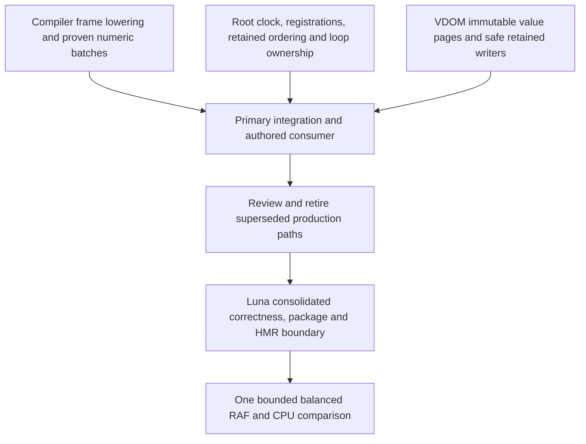

# Declarative realtime frame program

Completed boundary: [V9 results](results.md). Source and installed proofs verify clock/callback lifetime, numeric DAG batches, mixed structural/state-only admission, accepted history, retirement and HMR. The sole timing episodes retain CPU publication-p90 inconclusive status and scoped native RAF freshness/cost results. Pending rows below describe the original dispatch inventory; this completion record supersedes their verification status, while explicit open capabilities remain open.

Approved scope, 23 October 2026. Baseline main: 4d8b80a7250ee6744f5f463a5d6a75738ddddb29. This is an integrated implementation wave, not a per-helper timing campaign. The full master plan remains authoritative.

## Locked requirements

1. Native compiler-owned `useFrame()` reads a root-owned clock with `elapsed` and `delta` in seconds and `timeMs`/`deltaMs` in milliseconds. Clock state is a canonical Store using existing World/reader/history authority, not another animation state model.
2. `useFrame(callback, dependencies, options?)` registers mount-owned imperative logic. Explicit dependencies refresh captures; execution is once per new tick before publication, never speculative candidate evaluation. Stable site/owner identity governs registration and retirement. Options support deterministic phase/priority ordering and explicit named dependency edges; graph construction/cycle validation happens on registration changes, not every frame. Arbitrary callbacks are neither pure nor fusible.
3. Compiler ABI: lower authored calls to `useFrameAt(siteId, callback?, dependencies?, options?)`; zero-argument authored reads must feed the same closed Store numeric proof/batch machinery as `use(store)`. Runtime primitive lives in component_state_runtime; public spellings/exports live in native_runtime_api. No unverified handwritten execution metadata for the product proof.
4. One loop owns RAF: clock publication input and ordered callbacks, dirty compiled-region evaluation, direct host prop writes, accepted publication, draw. Existing createNativeFrameLoop remains the driver, not a second scheduler. Add declarative FrameLoop ownership through a native component boundary with a draw callback; mounting/unmounting controls the existing driver. Multiple loops on one root must fail clearly rather than tick the same registrations twice. Keep explicit imperative construction useful for adapters/tests.
5. Stable mounts retain structure, resources, computations, adjacency, input bindings and host writer geometry. Ordinary scalar frames must not reconstruct components/JSX/VDOM trees or topologically sort. Existing dirty journal and dependencies select/deduplicate work. Reuse existing emitted cross-instance batch kernels and shared-expression DAG, extending proof where needed. Dirty structural/opaque paths use the real generic reconciler.
6. Reduce remaining per-owner accepted output/cache/VNode successor work via shared immutable accepted value pages and lazy observation where source consumers permit. One accepted history and one publisher; old observed snapshots remain immutable across updates/forks/reentry. Retire replaced machinery instead of keeping duplicate fast/legacy implementations. Do not eagerly copy whole trees.
7. Writer batching may skip reflection/checks only under a real nonreentrant canonical host capability; arbitrary host callbacks retain current defensive semantics. Retain exact captured acknowledgement, newer actions, final liveness, resource lifetimes and partial-host failure quarantine. No rollback promise.
8. Keep ordinary inactive-transition/fork frames cheap through the same authority. Dependencies select consumers; explicit coherent groups select outputs that must agree. Independent DOM cadence is supported. Whole-tree candidates retain whole-root guards until genuinely mergeable deltas exist.
9. Preserve the loader DAG and its shared demand, hard prerequisites, independent reveal, cancellation/revision ownership. This wave does not replace it with a new callback DAG or infer arbitrary hidden side effects. Main-thread ordering/batching comes before workers.
10. Verification includes actual compiled clock-derived props, stateful callbacks, ordering/cycles/capture refresh, structural fallback, retirement/HMR, reentry/throws/forks/old snapshots, real installed hosts and balanced resources. Benchmark natural RAF native declarative props / React declarative props / idiomatic R3F useFrame-ref, plus matched prechange/current CPU control. Report requested/accepted/drawn epochs, deadline/freshness and median/p90; preserve p95/max. No claim of physical presentation from CPU/readback timestamps.

## Ownership and dependency graph

Sol A owns compiler Rust modules, compiler/vite_native_module.ts and new compiler frame fixture. Sol B owns src/component_state_runtime.ts, src/native_frame_loop.ts, a new src/native_frame_program.ts if useful, and new frame runtime tests. Sol C owns src/vdom_snapshot_runtime.ts, src/mounted_scalar_output.ts if present, and its new regression tests. Primary owns public API/exports, docs, application integration and source review. No implementation agent executes tests/builds/benchmarks. Coordinate ABI changes by message, not edits to another packet.

## Replacement, authorities, budget and falsifiers

Replace user-managed RAF Store dispatch/ref mutation and transient eligible per-owner descriptions with retained compiled frame execution. Existing World/Store source identity/dirty journal, Root owner/cache/history and VDOM publication/domain lifetime remain authoritative. Frame registration topology is necessary callback lifetime/order data, not another source-version or dirty registry. Baseline measured publication median/p90 is 1.90/2.10ms versus React 0.60/0.70ms on a synchronous 256-mesh control; no removable-time budget or predicted speed is established. Success requires the declared behavior and a bounded integrated comparison, not lower isolated helper timings. Any missed update, stale closure, duplicate tick, invalid ordering, old snapshot mutation, lost newer action, dead writer/resource use, false acceptance after partial host failure or source mismatch falsifies the slice. Unimplemented recommendations remain explicitly open, not silently reduced away.

## Integration decisions and remaining boundaries

The implemented source draft uses existing numeric owner programs for the common stateful callback case: an actual callback performs a functional state update once per tick, and the proven state prop binding writes directly without reconstructing its component. Capturing changing state, opaque render work or unproved callback dependencies retains generic execution. Clock reads, simple destructuring and per-instance own numeric props use the shared Store projection/numeric batch path. These are source claims awaiting the consolidated gate.

VDOM retains mounted scalar wrappers and advances their immutable image pointers under the existing accepted journal. Scoped candidates capture the old image alongside node identity. Root keeps immutable ComponentOutput successors and conditionally reuses the mounted cache object only for the sole ordinary candidate with no retained alias channels; structural/resource/coordinated work keeps canonical cache cloning. General unconditional cache reuse is open. Existing immutable numeric batch pages remain the value authority.

No current host declaration proves nonreentrancy: HostPropertyCapability explicitly allows throw/reentry. Therefore this wave retains defensive writer checks rather than adding a caller-forgeable fast flag. A stronger canonical host capability is an explicit remaining requirement, with source/lifetime proof required before skipping checks.

The built-in private clock controller currently owns one Root. Existing explicit multi-root Store publication remains supported. Sharing builtin frame clocks and local callback cuts across explicitly coherent multiple Roots requires a further queue/transaction integration; independent DOM cadence does not require that group. Full-tree Root candidates retain publicationVersion guards. Standalone VDOM prepareCommit uses structural version only (a preexisting gap in standalone stale-candidate rejection); page reuse does not broaden its protection, and no universal stale-preparation guarantee is claimed for that low-level API.

Full product obligations remain: loader dependency discovery and safe mergeable same-root deltas; optional coherent multiple host cuts; resource/host conformance and copy/borrow/retain policies; real lifecycle/cold/retained-memory costs; portable packages with the accepted quick OS smoke; independent-device qualification; and honest maintenance evidence. Historical wins and losses are not reclassified. These are tracked in the master plan rather than silently declared complete by the frame API.

## Tail-of-discussion task inventory

The human specifically reconfirms that compaction must not narrow this list. Status below distinguishes source work from verified delivery.

| Task | Current disposition / next dependency |
| --- | --- |
| Built-in clock read, callback hook and declarative RAF ownership | Source integrated; consolidated correctness running |
| Stable owner/site callback lifetime, explicit captures, deterministic phase/priority/dependency ordering, cycle handling | Source integrated; correctness and resource lifetime checks running |
| Retained pure computation graph, shared-expression hoisting and cross-instance batching | Existing numeric DAG/batch authority extended for frame clock and own numeric props; actual compiled proof pending |
| Dirty selection/dedup and direct prop writes without manual refs | Source integrated through existing World/owner programs; actual compiled and natural RAF proofs pending |
| Stateful callback functional updates without rerendering eligible component | Source integrated for bounded proved captures/options; isolated actual compiled no-render oracle pending; opaque/state-capture forms remain fallback |
| Clock destructuring and varying numeric component props, with local state | Source integrated; empty optional retained children exposed an admission gap in the actual compiled mixed fixture; repairing through the existing templates before qualification |
| Retained VDOM/mounted resources and immutable accepted value pages | Warm VNode successor retired in source; snapshot/fork/group-failure checks pending; per-row image/target records remain |
| Reduce transient Root output/cache work without new receipt/version registries | Ordinary sole-candidate cache reuse source integrated; active coordination retains clones; immutable output successors remain |
| Safe typed host writer batches | Open: current capability permits throw/reentry; need genuine canonical nonreentrant capability before removing defensive checks |
| Inactive transition/fork/coherent-group costs | Ordinary route contracts in source; active coordination and whole-tree guards preserved; measure integrated costs |
| Multiple hosts and explicit optional DOM/canvas coherence | Existing explicit groups remain; built-in private frame clock/local callback cut currently one Root; queue integration for coherent multiple Roots open |
| Loader/dependency DAG, shared demand, cancellation, revision ownership and independent reveal | Existing implementation preserved; broader dynamic discovery/control dependencies and mergeable same-root deltas remain master-plan work |
| Structural/opaque fallback, live ownership, exact ack/newer actions, forks and partial-failure quarantine | Required regressions in consolidated boundary; no arbitrary host rollback or visual atomicity claim |
| Delete replaced production mechanisms; avoid parallel implementations and benchmark-only product code | Source review and retirement accounting required at boundary; historical evidence preserved separately |
| Matched production performance and honest React comparison | One bounded balanced prechange/current CPU control plus natural RAF native props / React props / R3F callback-ref episode after correctness/delivery; median+p90 primary, raw p95/max preserved |
| Frame freshness/deadlines and actual requested/accepted/drawn epochs | New RAF consumer authored; installed proof/runner and comparison pending; physical presentation not inferred |
| Lifecycle/cold/setup/retained-memory/resource costs, host conformance, packaging and quick OS smoke | Full master-plan requirements retained; not closed by warm timing or an architecture matrix |
| Independent-device and human maintainability evidence | Open; no universal speed, smoother presentation or maintenance-advantage claim |
