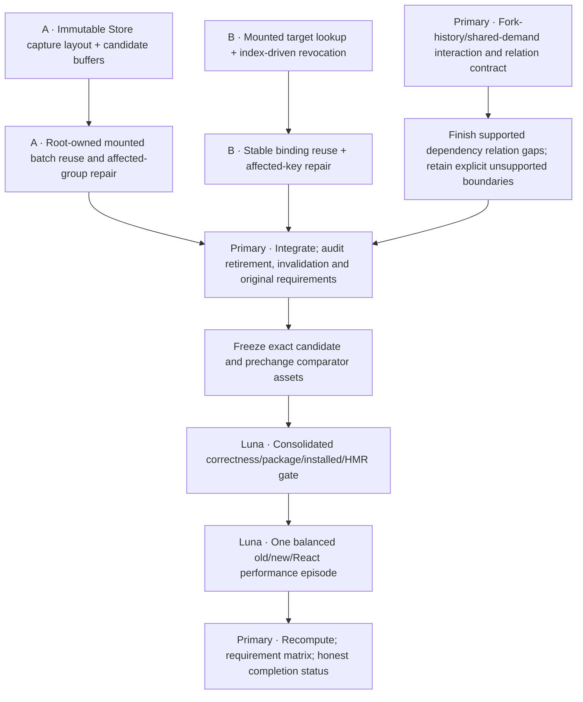

# Complete the audited execution gaps

Authorized by the human on23October after the independent three-slice audit. Implement the missing work as an integrated slice, with two Sol-medium implementation agents and primary integration/review. Luna remains idle until a reviewed source freeze. Tests that exercise interacting features are evidence; they do not require another runtime receipt system.

## Dependency graph

## A: mounted Store execution

Sol A owns `closed_store_execution.ts`, `owned_closed_frame_input.ts`, `component_state_runtime.ts`, narrow capture-reader changes in `async_store_runtime.ts`/`owner_state_world.ts` and related tests. Replace the per-cut execution grouping trie, row/column schema assembly and append/seal schedule construction with immutable geometry retained under existing Root/component output-shape authority. Capture values/action cutoffs and output storage remain candidate-private. Source/code/binding/order changes invalidate affected templates; unchanged groups reuse their layout. No shared writable scratch across reentry or candidates, unbounded cache, second accepted history or independent version registry.

Required source evidence: stable frames reuse layout; a membership/rebind/topology/code/owner-lifetime change repairs or declines through existing fallback; unchanged templates survive local repair. Retire the replaced production construction path on eligible frames. `StoreRenderTransaction` remains a legitimate transient semantic cut and is not removed merely to reduce object counts.

## B: mounted target execution

Sol B owns `vdom_snapshot_runtime.ts`, host property contract/Three host only as necessary and related tests. Resolve stable target/layout work from the existing mounted/key index authority, before rebuilding a bucket on stable frames. Index attach/detach/refresh must revoke affected lookup/bindings, including duplicate-owner ambiguity; affected-key repair cannot become a same-key quadratic scan. Preserve immutable snapshot values while reusing private mounted binding geometry. Retire per-frame stable bucket/owner reconstruction and avoid minting stable geometry again after each publication.

Keep full fresh reader/target sweeps, per-write and final checks until every relevant revocation path is covered. A writer can reenter even when values are scalar/copy-valued. Stabilize writer identity only where the current host authority can safely detect replacement; unsupported mutable/accessor hosts retain defensive behavior. Document any remaining reflection rather than pretending it disappeared.

## Primary dependency and integration work

Use actual root-specific Store transitions to demonstrate demand sharing while accepted inputs diverge, converge and cancel; a root merely named fork is insufficient. Cover last-interest abort, retained accepted output, changed-input pruning and code retirement through the existing queue/resource model. Audit hard prerequisites, control inputs and candidate-local discovery against supported compiler syntax and actual runtime invalidation. Fill a concrete supported-path gap where found; do not add a new generic graph/receipt layer merely because metadata fields currently share a scheduler representation.

Arbitrary helper/dynamic-key discovery and general same-root whole-tree delta merging are separate unfinished master-plan capabilities. Conservative diagnostics and whole-root guards remain until their semantic prerequisites exist. This unit must report those boundaries explicitly, not claim the full master plan or automatic discovery is finished. The two implementation agents may take subsequent bounded dependency tasks after their owned mounted work is reviewed; no concurrent overlapping file ownership.

## Shared semantics and falsifiers

Root/World/Store/VDOM/resource/module authorities remain canonical. Preserve exact acknowledgements, newer reentrant actions, per-root accepted histories, immutable old observations, ownership/writer/code liveness, resource lifetime, explicit coherent groups, generic fallback and partial-failure quarantine. No replay after host writes. Static reusable geometry contains no mutable accepted values or correctness-critical finalizer. Missing revocation, false duplicate-owner admission, stale code/target reuse, action loss or changed callback order blocks release.

Tests should prove behavior and retirement using untimed counters where useful; no per-helper timings. Primary audits source and meaningful adversaries before Luna runs the consolidated frozen-Deno/Rust/actual-compiled/package/installed boundary. Preserve failures; repair demonstrated causes under distinct receipts, without repeated already-passing gates unless changed inputs require them. All browser workloads stay bounded, headless and interruptible. Any server uses Portless HTTPS after its skill is loaded. No VM work is selected.

## Performance acceptance fixed before measurement

The user requested no regression within measurement uncertainty. Historical Slice2 values are context, not an old/new experiment. Use identical authored dense realtime consumers, outputs, dependencies, production minification and update/draw intervals for immutable prechange and integrated candidate assets. Include the React arm as a contemporary control. Verify exact source/build/asset hashes and matching outputs before timing. No build/source/Git/test activity overlaps timing.

One bounded balanced episode interleaves prechange and candidate contexts in both orders, with React controls distributed through the episode. Retain per-context median and nearest-rank p90, raw p95/max and all samples; do not pool frames as independent repetitions. Use12warmups/60measured frames per context and a fixed context sequence in the protocol before authorization. No favorable retry.

For non-regression, report paired context/block candidate-minus-prechange changes for update and throughdraw median/p90. Predeclare tolerance as the larger of5% of prechange latency and one observed timer quantum. Calculate a block-level one-sided95% uncertainty bound using a fixed resampling method/seed. Claim within-margin only if the upper bound is at or below that tolerance for all required metrics; otherwise report regression or inconclusive. This finite single-machine episode cannot guarantee no regression on every app/device. A wide bound is not permission to widen tolerance or rerun for favorable evidence.

No removable milliseconds are promised. Retirement and same-run non-regression are separate findings. Cold/setup, allocation/retained memory, portability/conformance and independent-device/human evidence retain their original finish-line status.
