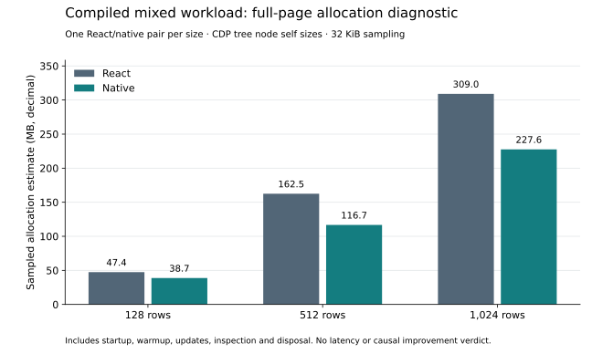

# Native cell-cut allocation findings

13 October 2026. The compiled native arm has lower sampled allocation estimates
than React Compiler in this diagnostic. This is not a latency or release verdict.

## Evidence

Preregistered run `86270bc6-5416-4c93-81ec-877ff41c5905` collected one fresh
React/native pair at each size. All six pages pass, and independent verification
passes 109/109 checks, including raw-tree aggregation, attribution tuples,
served-source excerpts and pre/post locks. Scope includes import, mount, 60 warmup
and 240 measured frames, correctness inspection and disposal. Sampling includes
collected objects at a 32 KiB interval.

| Rows | React tree self sizes | Native tree self sizes | Native / React |
| --- | ---: | ---: | ---: |
| 128 | 47.40 MB | 38.73 MB | 0.817 |
| 512 | 162.49 MB | 116.69 MB | 0.718 |
| 1,024 | 309.03 MB | 227.60 MB | 0.736 |

Decimal MB, summing node `selfSize` without double-counting inclusive ancestors.
These sampled totals are approximately 18–28% lower for native in this run.
Flat sample totals are independently preserved and differ slightly from the tree
totals. Some CDP flat samples reference node IDs absent from the stopped tree;
those are retained diagnostics, with no forced reconciliation of the two forms.
One pair per size supplies neither confidence intervals nor a release allocation
gate. Historical profiles are not pooled, and differences between checkpoints
cannot be attributed to one optimization from these observations.

## Remaining allocation contexts

At 1,024 rows, verified emitted frames identify 29.52 MB in the committed World
state setter, 8.07 MB in the source-program execution closure, 26.98 MB across
the three authored CSS projections, 3.40 MB in generic source batching, and
37.53 MB in the common correctness inspector. The generic batching frame remains
because mixed structural candidates use it. These frame self sizes are not
exhaustive subsystem totals or exact allocation-statement attribution.

Builtin frames add substantial allocation: `Set` contributes 25.74 MB, `delete`
23.22 MB and `set` 13.61 MB. The recomputed nearest-emitted-ancestor ledger places
24.40 MB of `Set` and 9.49 MB of `set` under the World setter, and 22.63 MB of
`delete` under `clearCellChangesThrough`. Those caller contexts are coarse. The
World source confirms recurring creation of dirty-site sets and removal of empty
dirty-owner map entries; profiling alone does not establish their CPU cost.

The next timing comparison should use this archived candidate before another
storage family is introduced. If it misses the speed gate and current attribution
supports dispatch work, the bounded next storage experiment is a persistent
ordered dirty journal, preserving public owner/site ordering, version cuts,
preparation publication and destruction. Full numeric column storage remains
conditional on evidence. This diagnostic does not justify a B+ tree or Wasm cut.

## Limits and provenance

Post-disposal forced-GC JS heap is approximately 2.27–2.34 MB React and 2.73–2.79 MB
native. Thus lower allocation totals do not establish lower retained heap.
These readings are after teardown, not mounted memory or proof of leak freedom;
they exclude DOM, GPU and presentation memory. Profiled commit times do not enter
the speed decision. Independent-device and comparative maintenance gates remain
open, and the Sol full review remains held.

- Protocol: `product-mixed-native-cell-cut-memory-protocol.md`.
- Raw records: `results/product-mixed-native-cell-cut-memory/`.
- Independent verifier: `scripts/verify_product_mixed_native_cell_cut_memory.mjs`.
- SVG and ledger: `results/product-mixed-native-cell-cut-memory-analysis/`.
- Reproduction: `scripts/summarize_product_mixed_native_cell_cut_memory.py` with
  matplotlib 3.10.8, from the project root.
- Source/build checkpoint: `implementation/2026-10-13-native-cell-cut/`, SHA-256
  `1687915fd6d6ba51d457a4265100e0c72eed5e2641af230257fd29185ec3ac45`.
