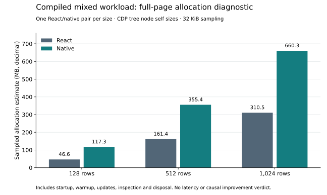

# State-resolution allocation findings

The current compiled runtime passes its correctness qualification (495 runtime,
28 Rust and 50 integration checks including six production pilot pages), but
allocation remains a material weakness against the React Compiler baseline.
This diagnostic establishes where to work next; it does not establish speed.

## Evidence

The preregistered run `4d9ff53a-91ba-4e2a-bd99-f8ac5629821a` sampled one fresh
React/native pair at each size. Scope includes import, mount, 60 warmup and 240
measured frames, correctness inspection and disposal. CDP sampling includes
collected objects at a 32 KiB interval. Raw profiles, separately summed flat
samples and the independently verified ledger are preserved.

| Rows | React tree self sizes | Native tree self sizes | Native / React |
| --- | ---: | ---: | ---: |
| 128 | 46.58 MB | 117.32 MB | 2.52 |
| 512 | 161.38 MB | 355.39 MB | 2.20 |
| 1,024 | 310.52 MB | 660.29 MB | 2.13 |

Decimal MB; estimates from tree node **self** sizes, without repeatedly summing
inclusive ancestors. Flat sample sums are a separate CDP representation and do
not have to equal the tree sums. One pair per size supplies neither confidence
intervals nor a release allocation verdict.

At 1,024 rows, verified emitted native frames identify approximately 83.18 MB
in the committed state setter, 81.04 MB in source batching and 73.50 MB in root
numeric-flush preparation. Root `flush` contributes 33.49 MB. The matched
controller/harness frame contributes 35.70 MB native and approximately 36.48 MB
React. These are individual frame self sizes, not exhaustive subsystem totals.

Builtin `set`, `add`, `next`, `delete` and `Set` frames contribute substantial
additional allocation. The ledger preserves nearest emitted ancestor context;
inlining prevents exact statement attribution from that context alone. React's
emitted function named `gc` is a state update function, **not** a garbage
collector frame. Anonymous authored CSS projections remain separately recorded.

## Implementation direction

The recurring native path creates state notification objects, listener snapshots,
dirty owner/site containers, root pending-write records and update tuples, then
VDOM source maps and affected binding sets. The next bounded cut should use
stable committed cell handles, persistent pending slots and captured versions.
Public subscribers must still receive independent immutable change snapshots;
async candidates must retain independent captures. Reentrant updates must stay
pending after acknowledgment of an older cut.

After that, executable compiler source/sink programs can avoid repeated generic
source normalization where compiler facts prove unique source identities. Public
batch APIs must retain duplicate-source semantics. Mixed collection/numeric
candidates must continue through one validated host/publication lifecycle.

These findings do not justify changing the retained VDOM to a B+ tree yet. We
have identified allocation in dispatch and preparation before proving that
topology traversal or cache locality is the dominant remaining cost.

## Reproduction and provenance

- Protocol: `product-mixed-state-resolution-memory-protocol.md`.
- Raw records: `results/product-mixed-state-resolution-memory/`.
- Corrected independent verification: `verification-corrected.json`, 101/101.
- First `verification.json` remains FAIL: its validator incorrectly rejected
  null builtin excerpts and compared object records by JSON property order.
  Only the verifier changed; collection was not rerun or selected.
- Analysis: `scripts/summarize_product_mixed_state_resolution_memory.py`, Python
  with matplotlib 3.10.8; SVG text remains editable. Run from the project root.
- Source/build archive: `implementation/2026-10-12-state-resolution/`, SHA-256
  `709e184ef1fc7dbd2e8020a1dfdfd2b6d6050ef2d333c3a482cb1540921fae6d`.

Post-disposal GC heap is approximately 2.24–2.34 MB React and 2.43–2.49 MB native;
this is not mounted memory or proof of general leak freedom. JS sampling excludes
DOM/GPU memory. No causal improvement over older checkpoints, latency advantage,
independent-device result or comparative maintenance verdict follows from this
diagnostic. Existing performance gates remain open and the Sol review stays held.
